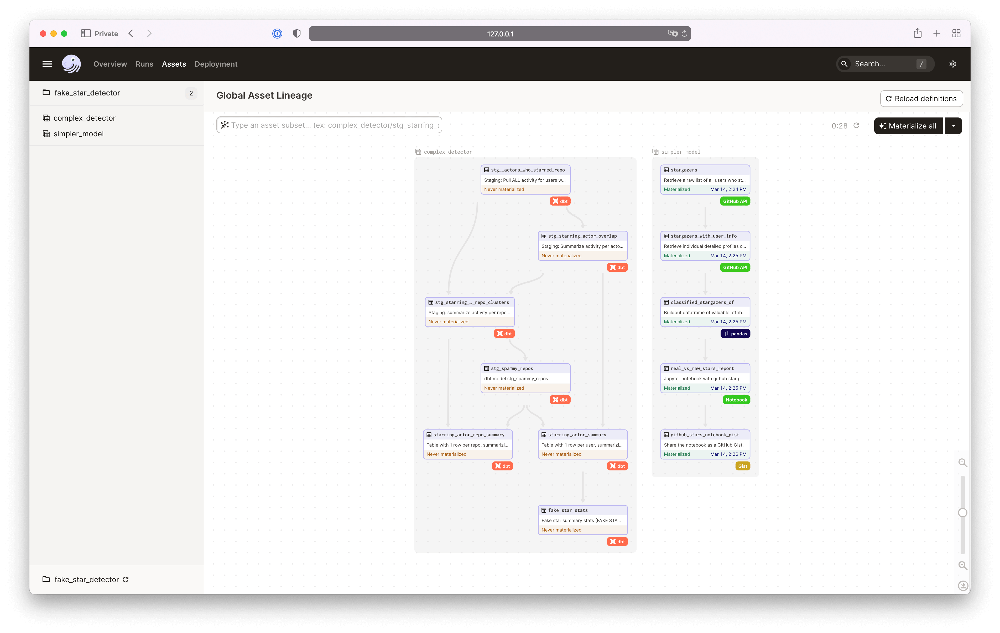
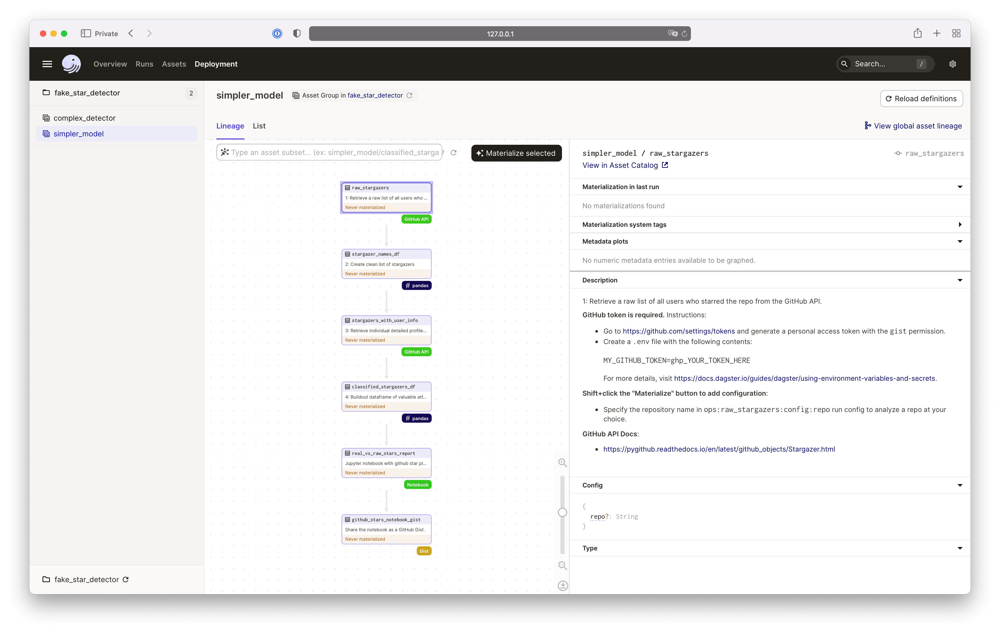
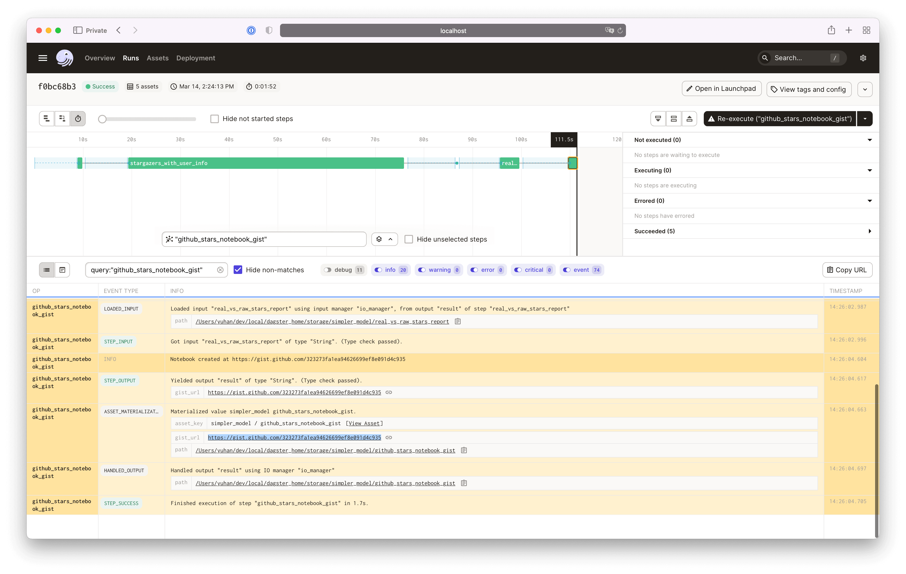
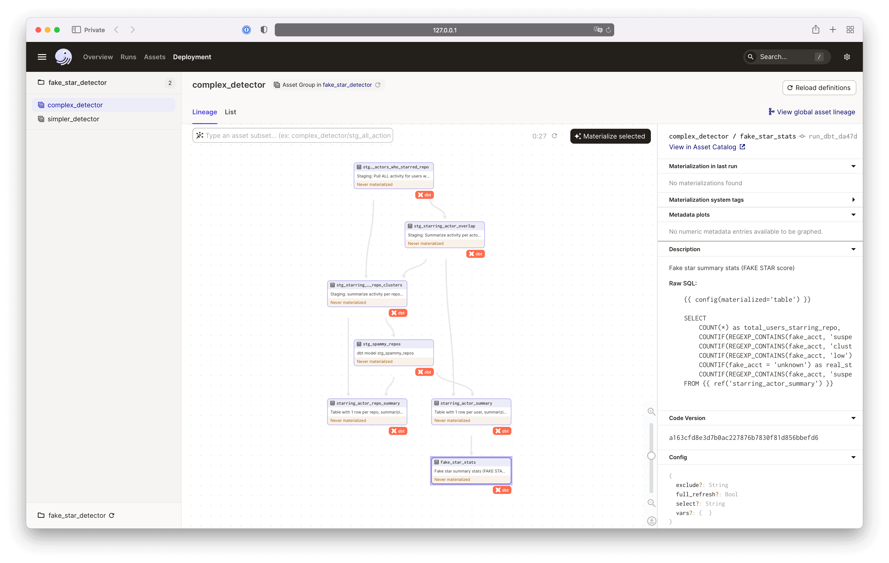

# fake-star-detector: A Dagster tutorial

This is a simple Dagster project to analyze the number of fake GitHub stars on any GitHub repository.  It is a companion to the blog post found [on the Dagster blog](https://dagster.io/blog/fake-stars).


This project consists of two models:
- [Simpler model](#trying-the-simpler-model-using-data-from-the-github-api): A simple model running “low activity” heuristic. This simple heuristic can detect many (but hardly all) suspected fake accounts that starred the same set of repositories, using nothing but data from the GitHub REST API (via [pygithub](https://github.com/PyGithub/PyGithub)).

- [Complex detector](#running-the-complex-model-using-duckdb-archive-data): An alternative detection model which runs a sophisticated clustering algorithm as well as the heuristic, using the public [GH Archive](https://www.gharchive.org) data. This model is written in SQL and uses [dbt](https://github.com/dbt-labs/dbt-core) with [DuckDB](https://duckdb.org/) alongside Dagster.
  * *Note: You can run this within the limits of a free-tier BQ account, but the analysis will be reduced in scope. By default, this model only scans data in 2023 on a small repository, in order to make it stay within the free-tier quota.*

<p align="center">
    
</p>

## Table of contents
- [Table of contents](#table-of-contents)
- [Getting started](#getting-started)
  - [Install instructions](#install-instructions)
    - [Getting GitHub Access Token for the simpler model](#getting-github-access-token-for-the-simpler-model)
  - [Setting up your local environment](#setting-up-your-local-environment)
    - [Cloning the repo](#cloning-the-repo)
  - [Building a virtual environment](#building-a-virtual-environment)
  - [Running Dagster locally](#running-dagster-locally)
- [Trying the simpler model using data from the GitHub API](#trying-the-simpler-model-using-data-from-the-github-api)
  - [Setting up the environment variables](#setting-up-the-environment-variables)
  - [Running the model](#running-the-model)
    - [Troubleshooting](#troubleshooting)
  - [Explanation of the model](#explanation-of-the-model)
- [Running the complex model using DuckDB archive data](#running-the-complex-model-using-duckdb-archive-data)
  - [Setting up the environment variables](#setting-up-the-environment-variables-1)
  - [Running the model](#running-the-model-1)
  - [Explanation of the model](#explanation-of-the-model-1)


## Getting started

### Install instructions

For this tutorial, we assume you have Git installed. Installation details can be found here: https://github.com/git-guides/install-git.

#### Getting GitHub Access Token for the simpler model
For running the [simpler model](#trying-the-simpler-model-using-data-from-the-github-api), you will also need a GitHub Personal Access token to access the GitHub API. This can be created in GitHub here: https://github.com/settings/tokens (after logging in to GitHub). Keep the new access token handy as we will be needing it shortly.

Note: we'll need `gist` scope because we're going to create a Gist to be the final report in the end.


### Setting up your local environment

#### Cloning the repo
You will need to pull a copy of this repository onto your local machine, go into the top level of the cloned repository and run the install command:

```commandline
git clone https://github.com/dagster-io/fake-star-detector.git
cd fake-star-detector
```

### Building a virtual environment

Install Dagster and our other dependencies. This project uses the modern `pyproject.toml` configuration and follows dg CLI best practices.

**Using pip:**
```commandline
python3 -m venv venv
source venv/bin/activate

pip install -e ".[dev]"
```

**Using uv (recommended):**
```commandline
uv venv
source .venv/bin/activate

uv pip install -e ".[dev]"
```

### Running Dagster locally

Start the Dagster UI web server using the modern `dg` CLI:

```commandline
dg dev
```

Open http://localhost:3000 with your browser to see the project.

**Project Structure:**
This project follows the modern Dagster project structure:
- `src/fake_star_detector/` - Main source code
- `src/fake_star_detector/definitions.py` - Entry point with Definitions object
- `src/fake_star_detector/defs/` - Organized definitions (assets, resources)
- `src/fake_star_detector/defs/assets/` - Asset definitions
- `src/fake_star_detector/defs/resources.py` - Resource definitions

**Data Storage:**
All asset outputs are stored directly in DuckDB using SQL:
- Simpler model assets → Insert data directly into DuckDB tables using `DuckDBResource`
- Complex model assets (dbt models) → Stored as tables in DuckDB via dbt
- Single database file: `data/fake_star_detector.duckdb` (configurable via `DUCKDB_DATABASE` env var)
- No pandas DataFrames in the data pipeline - everything uses DuckDB SQL directly

**Partitions:**
All simpler model assets are partitioned by repository. You can process multiple repositories independently:
- Each repository is a separate partition
- Materialize specific repositories or all repositories at once
- Data is stored with a `repo` column to keep partitions separate
- Add repositories by editing `src/fake_star_detector/defs/partitions.py`

Next, you can run the detection model(s) of your own choice.

- Simple, more complete history, and no cost: [Simpler model](#trying-the-simpler-model-using-data-from-the-github-api) -- This model uses data from the GitHub API to detect fake stars. You may hit GitHub API limit depending on how many activities the repository you choose to analyze.
- Comprehensive, local analysis: [Complex model](#running-the-complex-model-using-duckdb-archive-data): This model uses the public [GH Archive](https://www.gharchive.org) data with DuckDB. All data is stored locally in a DuckDB database file, so there are no cloud costs. You can analyze any time period and repository size.

## Trying the simpler model using data from the GitHub API
### Setting up the environment variables 
This model requires GitHub Access Token to access the GitHub API. Refer to the instructions [above](#getting-github-access-token-for-the-simpler-model) for how to obtain your own token.

Then, create a `.env` file at the root of the repository you just cloned and add your GitHub access token as a variable:

```
GITHUB_ACCESS_TOKEN=<<GITHUB_ACCESS_TOKEN>>
```


### Running the model

<p align="center">
    
</p>

Navigate to `simpler_model` from the left nav in the UI. The assets are partitioned by repository. You can:

- **Materialize a specific repository**: Click on an asset, select a partition (repository) from the partition selector, and click "Materialize"
- **Materialize all repositories**: Click "Materialize all" to process all repositories defined in the partitions
- **View partition status**: Each partition shows its materialization status independently

At the end of the job, it will output a Gist summarizing the analysis for that repository. You can find the link in the compute log:

<p align="center">
    
</p>

**Adding More Repositories:**

To analyze additional repositories, edit `src/fake_star_detector/defs/partitions.py` and add them to the `REPOSITORY_PARTITIONS` list:

```python
REPOSITORY_PARTITIONS = StaticPartitionsDefinition([
    "frasermarlow/tap-bls",
    "dagster-io/dagster",
    "your-org/your-repo",  # Add your repositories here
])
```

After adding repositories, restart `dg dev` to see the new partitions in the UI. Each repository will appear as a separate partition that can be materialized independently.


#### Troubleshooting

If you are using the default Dagster storage backed by SQLite, you may encounter an error as:
```
sqlalchemy.exc.OperationalError: (sqlite3.OperationalError) unable to open database file
```

To get your pipeline successfully running, you can Shift+click "Materialize all" on the asset graph page and add the following configuration. This will turn off the default multiprocessing execution.

```yaml
execution:
  config:
    in_process: null
```


### Explanation of the model

This asset group is a Dagster project and involves 3 main assets:

1) Asset `stargazers`: We call the GitHub API and retrieve a list of users who have starred the repo, storing the data in DuckDB.
2) Asset `stargazers_with_user_info`: We look up each user in turn and pull their detailed profile from the GitHub API, storing enriched data in DuckDB.
3) Asset `classified_stargazers`: We analyze each profile using SQL heuristics in DuckDB to determine if they are fake or not, storing the classification results.

In addition to the above, we have helper functions:

a) `_fetch_user_details_if_exists`: Verifying that a user still exists before pulling the full details
b) `_handle_exception`: Handling exceptions for the GitHub API call. This calls `_calculate_retry_delay_for_rate_limit_exception` which returns the retry delay based on the `x-ratelimit-reset` value for the GitHub API.

Currently, the pipeline will simply return a result in the Dagster UI as in `INFO` event type such as "Score is 12.34% fake stars" and will provide a list of usernames flagged as fake.

## Running the complex model using DuckDB archive data

This model is written in SQL and uses dbt with DuckDB. You can find the dbt project in the [`dbt_project`](./dbt_project/) directory, and the dbt models in the [`dbt_project/models/complex_detector/`](./dbt_project/models/complex_detector/) directory.

### Setting up the environment variables

This model uses DuckDB, a local analytical database. No cloud account or credentials are required!

Add the following to your `.env` file to specify where the DuckDB database file should be stored:

```
DUCKDB_DATABASE=data/fake_star_detector.duckdb
```

The database file will be created automatically when you run the model. You can use any path you prefer.


### Running the model

Navigate to `complex_detector` in the UI. Click "Materialize all" to kick off the complex model. This defaults to analyze `frasermarlow/tap-bls`.

<p align="center">
    
</p>

In the end, you'll get a few DuckDB tables with the final result stored in your local database file.


To check out for another repository, edit the "target_repo" in [`./dbt_project/models/fake_star_detector/stg_all_actions_for_actors_who_starred_repo.sql`](./dbt_project/models/complex_detector/stg_all_actions_for_actors_who_starred_repo.sql):
```

```


### Explanation of the model

This loads a dbt project which uses GitHub Archive data to identify suspicious users who starred the given repository, and estimates a FAKE STAR score for that repository using two separate heuristics
to catch different types of fake accounts.

The dbt project materializes 4 DuckDB tables with estimated FAKE STAR score, and a few staging views:
1. `stg_all_actions_for_actors_who_starred_repo`: all activity for users who starred repo in the given time period
2. `starring_actor_summary`: table with 1 row per user, summarizing similarity to other users in a set.
3. `starring_actor_repo_summary`: table with 1 row per repo, summarizing similarity to other repositories actors touched.
4. `fake_star_stats`: fake star summary stats (FAKE STAR score).
